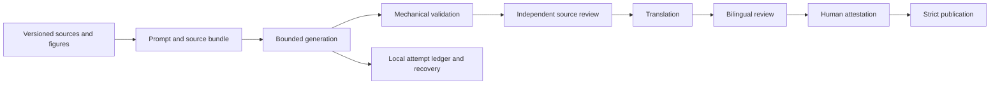

# Architecture

The default demo replays synthetic content; live generation is optional. Source evidence and questions stay outside reader prose. Source and reader hashes invalidate stale acceptance. Only generated static output enters the deployment artifact.
